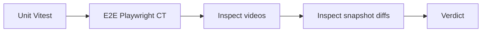

# Component Testing Skill (`test-component`)

Use this skill whenever you need to **verify whether a component passes logic, behavior, and visual/motion requirements**.

`test-component` is a **pure verification skill**. It does not manage feature development or refactoring; higher-level workflows call it as their verification gate.

### Scope: `@reference-ui/lib` only

This skill covers colocated Vitest + Playwright CT for components in `packages/reference-lib`. It does **not** cover `packages/reference-core`, `packages/reference-rs`, matrix packages, or the pipeline.

If you modified `packages/reference-core` (sync, packager, runtime, bundler plugins, …), follow **agent-core** (`.agents/skills/agent-core/SKILL.md`). If you modified `packages/reference-mcp` (MCP) or a matrix or pipeline contract, **stop here** and follow **test-core** (`.agents/skills/test-core/SKILL.md`). That is the pipeline runner (`pnpm agent`). It is **not a skill** — it is the matrix and pipeline verification harness. `pnpm agentct` will not prove a Core or matrix change.

---

## Where Tests Live

| Kind | Location | Runner |
| --- | --- | --- |
| Unit | Colocated next to source: `src/components/<Component>/*.test.ts(x)` | Vitest |
| Component E2E | `src/components/<Component>/__e2e__/<ID>/<Component>.ct.spec.ts`, one case folder per `LIB-<COMPONENT>-<nnn>` | Playwright CT |
| Stories (CT fixtures) | `src/components/<Component>/<Component>.story.tsx` | Mounted by CT |
| Visual snapshots | `src/components/<Component>/__e2e__/<ID>/__snapshots__/*.png` | Playwright `toHaveScreenshot` |

Unit tests sit beside the code they cover. `__e2e__` is separate because those files are Playwright component tests against a real browser, not Vitest files.

Matrix contract tests in `matrix/*/tests/e2e` are a different layer (cross-bundler/runtime). Do not put component CT there.

## Case catalog and conformity

Every CT case is a folder `src/components/<Component>/__e2e__/<ID>/` named by its
raw ID (`LIB-<COMPONENT>-<nnn>`), holding `case.json` (`{"id", "name"}`), a
`README.md` whose first line is `# <ID> — <name>`, and one `*.ct.spec.ts` with one
declaration (AGENTS.md section 7). Unit declarations need no index: every
`*.test.ts(x)` outside `__e2e__/` is discovered, and each declaration is labelled
`<Component>/<file>:<line>`. `pnpm agentct` validates the full catalog before
verification; a broken case folder, misplaced evidence, disabled tests, and an
exported component with no evidence fail. The folder rules live in
`packages/reference-lib/testing/README.md`.

```bash
pnpm agentct check                    # Conformity only; no execution proof
pnpm agentct list                     # Registered cases; no daemon needed
pnpm agentct search "focus"
pnpm agentct run LIB-POPOVER-001       # One CT case folder
```

Static `it.each` tables are registered once using their unexpanded declaration
title; selecting a case requires all expected rows to pass. Missing reports,
zero-pass executions, skipped selected cases, and incomplete row counts cannot
produce a passing verdict. A component without a requested evidence layer fails
explicitly. Component targets match the exact directory, and concurrent jobs keep
artifacts in separate `playwright/test-results/agentct-<pid>/<react-major>/` paths.
Ordinary CT runs use `--update-snapshots=none`, so verification never creates
missing PNG baselines.

---

## What To Write Where

**Vitest (unit)** is for logic and functionality that does not need a browser:

- Pure functions, state machines, math, parsing, formatting, token merge
- SSR markup contracts (`renderToString`)
- Pointer/capability helpers, queue ordering, ID generation

Do **not** emulate the DOM in Vitest when you do not need to. Do not write JSDOM click/hover/focus theater for overlays, focus traps, or presence. If the assertion needs a real layout, pointer, keyboard, animation, or screenshot, it belongs in `__e2e__`.

**Playwright CT (`__e2e__`)** is where most "real" component tests live:

- Open/close, hover, Escape, outside click, focus return
- Presence enter/exit, anchoring, safe polygon travel
- Visual snapshots at settled states (resting / open / dismissed)
- Video of the interaction for motion review

---

## The Verification Loop



Always run **unit first**, then e2e on React 19, then inspect artifacts. From the repository root:

```bash
pnpm agentct                         # Run ALL components through the single-job daemon
pnpm agentct Popover                 # unit → e2e (React 19 + snapshots)
pnpm agentct Popover --unit
pnpm agentct Popover --e2e
pnpm agentct Popover --e2e --react 18
pnpm agentct Popover --e2e --react 17,19
pnpm agentct Popover --e2e --react all
pnpm agentct Popover --list                 # List tests (no queue slot used)
pnpm agentct Popover "OV-POS-10"            # Run an exact spec by its ID (ergonomic positional argument)
pnpm agentct Popover --id "OV-POS-10"       # Same as above
pnpm agentct Popover --line 509             # Deterministic line number targeting (useful for AI agents)
pnpm agentct Popover -g "escape"            # Fuzzy fallback (avoid if possible)
pnpm agentct daemon                         # Optional: keep Vite warm in your terminal
pnpm agentct stop                           # Stop the auto/persistent daemon
pnpm agentct --help
```

> [!IMPORTANT] 
> **AGENTIC FLOW & PERSISTENT DAEMON:**
> - **Human-readable verification output:** Do not pass `--json` for unit/CT jobs. Run `pnpm agentct` natively and parse the progress in the task logs. Catalog-only `list` and `search` may use JSON; invoke `pnpm --silent agentct ... --json` to keep package-script banners out of machine-readable stdout.
> - **One Vite, one active job:** `agentct` auto-starts a persistent Unix-socket daemon (`/tmp/ref-ct-agent.sock`) that owns a single CT Vite gallery on `http://localhost:3101`. The gallery starts when browser evidence is needed and stays warm for later jobs. Unit-only selections do not start Vite. Concurrent invocations share this daemon and wait their turn. One daemon serves every checkout and worktree, and each job runs in its own tree: its runner, specs, stories, CSS, Vite and artifacts. The gallery restarts when the tree changes. An older daemon that runs only its own checkout is refused before anything runs (exit 2). `pnpm agentct stop` stops the daemon for every tree, so stop it only when no other agent needs it. Contact sheets come after the Playwright summary, at about 10 s per recording, and the job slot stays held while they build.
> - **Resource budget:** the global queue permits **one** active verification job, including its units and all React browser runs. Vitest and Playwright use at most **two** workers. `CT_WORKERS=1` lowers the job budget; higher overrides are capped at two. The direct fallback shares the same execution lock.
> - **Scheduling:** run one local verification job at a time. Queue additional component work instead of launching independent browser servers or test fleets. Cancellation keeps the execution slot until the child stops and escalates the job's owned process groups, so detached Playwright server/browser leaders cannot outlive their slot. The direct fallback never takes over an existing listener on the CT port; `pnpm agentct stop` terminates active jobs and the daemon's owned groups.
> - **Snapshot telemetry:** when `toHaveScreenshot` fails, the reporter prints bounding box (`x: min..max`, `y: min..max`) and the dominant color hex difference. Use that before writing image-parsing scripts.
> - **Triaging Full Suite Failures:** Run `pnpm agentct` (no arguments) only when full-suite proof is needed. Read the failures, fix the relevant components, then verify each affected component through the same single-job queue.

Never pass `--update-snapshots` during this loop. Snapshot writes are a separate, human-gated step (see below).

The runner unthrottles Darwin QoS (`PRI 46`), runs colocated Vitest under `packages/reference-lib`, then Playwright CT against `packages/reference-lib/playwright/playwright.config.ts`. There is **no need** for `pnpm dev:lib` on port 5000 — CT uses the daemon's gallery on `http://localhost:3101`. A global `beforeEach` resets `window.scrollTo(0, 0)` so large fixtures cannot leak scroll into the next test. Do not kill port 3101 between agentct jobs; the daemon owns that process. Use `pnpm agentct stop` when you want it gone.

> [!CAUTION]
> **Styles staleness (proven 2026-09-27, B-08):** `agentct` e2e does NOT
> regenerate the stylesheet — after ANY edit that affects styles (recipe,
> `css()`, style prop, token), run `pnpm --dir packages/reference-lib sync`
> FIRST and confirm your rule in
> `packages/reference-lib/.reference-ui/react/styles.css` before trusting
> e2e. Without the sync, e2e verifies stale CSS and a visual fix shows a
> false green (observed: 11/11 pass on pre-fix CSS, intended snapshot red
> only after sync).

### React runtimes (no pipeline)

Matrix tests switch React via **test-core** (`pnpm agent` / Dagger). CT does **not**. `--react` points the CT Vite gallery at isolated `@ct-runtime/react-*` packages under `packages/reference-lib/playwright/runtimes`:

| Flag | Package | Mount |
| --- | --- | --- |
| default / `--react 19` | `@ct-runtime/react-19` | `createRoot` |
| `--react 18` | `@ct-runtime/react-18` | `createRoot` |
| `--react 17` | `@ct-runtime/react-17` | `ReactDOM.render` (`react-dom/client` + `useId` / `useSyncExternalStore` shims) |

`html[data-react-version]` is set from `React.version` so you can confirm the runtime.

**When to use `--react`**
- Day to day: omit it. `pnpm agentct <Component>` is React 19 + snapshots.
- After overlay / presence / event / mount work, or when the human asks about compatibility: `--e2e --react all` (or `17,18`).
- Unit tests always use workspace React 19. `--react` is e2e-only.
- Visual snapshots (`snap()`) run **only on React 19**. 17/18 are behavioral. `snap()` is a no-op off 19, so specs stay identical.
- Do not pass `--update-snapshots` with `--react 17`, `18`, or `all`. The runner refuses.

If the change that forced a React/host tweak lives in `packages/reference-core`, prove it with agent-core (`pnpm agentcore`), or with test-core (`pnpm agent`) when a matrix contract is involved, not this loop.

Human pairing: `pnpm playbook` opens the Playwright UI.

---

## Artifact Inspection (mandatory)

The runner prints absolute paths after e2e:

```text
✔ [PASSED] react19 popover opens on trigger click and closes on outside click (845ms)
  🎥 Video:      /path/to/.../video.webm
  🎞  Frames:     /path/to/.../frames.png
  📸 Screenshot: /path/to/.../test-finished-1.png

✖ [FAILED] react18 tooltip opens on hover ...
  🎥 Video:      /path/to/.../video.webm
  🎞  Frames:     /path/to/.../frames.png
  🧭 Trace:      /path/to/.../trace.zip
```

### Stills (`frames.png`)

The agent cannot play `.webm`, so the runner writes a `frames.png`
next to each video — up to eight stills showing the moments the picture changed,
laid out left-to-right in a grid, each labelled with its timestamp. The runner
densely seeks the recording and keeps the frames where the component actually
appears, so the sheet is not a black background. If nothing changed from the
first frame the sheet carries a red "no change from first frame" banner and the
runner warns on stderr. Open it with the Read tool and check:

1. **Presence & exit** — overlay enters with its animation; on dismiss it finishes the exit before unmount (no snap/flicker).
2. **Anchoring** — position vs trigger, arrow alignment, no jitter on flip.
3. **Focus** — `:focus-visible` rings visible; focus returns to the trigger.
4. **Pointer travel** — hover overlays stay open across the safe area.
5. **Layout** — no unexpected shifts or scroll jumps.

### Traces (failed tests)

Failed tests record a `trace.zip` (config: `trace: 'retain-on-failure'`; the old
`on-first-retry` never fired because there are no retries). Read it as text from
`packages/reference-lib`:

```bash
npx playwright trace open <trace.zip>
actions                 # every user action and its timing
errors                  # failures with stack traces
console                 # page console output
screenshot <action-id>  # PNG for one action
close
```

### Visual snapshots (drift)

Snapshots are **settled-state** comparisons (`snap(page, 'open')`, stored as `open.png`). Animations are disabled for the comparison so the check is about layout/paint drift, not motion (motion is the video). `snap()` no-ops unless the CT gallery is React 19.

On mismatch: read the **bbox + color telemetry** in the terminal, then open the **diff** (Read tool), then **actual**, then **expected**. Treat a failed snapshot as a **regression until the human says otherwise**. Fix the component. Do **not** update the baseline.

---

## Updating snapshots (human-gated)

Only update snapshots if they are genuinely updating styling, and it always has human verification.

`--update-snapshots` is forbidden unless all of the following are true:

1. The change is **genuine styling** — tokens, spacing, color, typography, chrome, or intended layout. Not a logic fix, flake, timeout, animation timing, font raster, or harness tweak.
2. You have shown the human **expected**, **actual**, and **diff** in chat (embed the images).
3. You have **stopped** and asked: *“This looks like an intentional styling update. Update the snapshot baselines?”*
4. The human has replied with an **explicit yes**. Silence, “looks fine”, or a later commit request is not approval.

Until that yes: do not run `--update-snapshots`, do not pass `--confirm`, do not copy pngs into `__snapshots__` by hand.

After an explicit yes:

```bash
pnpm agentct <Component> --e2e --update-snapshots --confirm
```

`--confirm` is the machine record that the human already approved. The runner refuses `--update-snapshots` without it, and refuses it with `--react 17`, `18`, or `all`.

Then show the new baselines in chat and wait if the human wants a second look.

---

## Structured Verdict

Return:

1. **Unit** — passed/failed, what logic was covered (always workspace React 19).
2. **E2E** — total / passed / failed, **per React major** (`react17` / `react18` / `react19`).
3. **Artifact paths** — videos, screenshots, snapshot expected/actual/diff (snapshots only on 19).
4. **Motion notes** — timestamped observations from the video.
5. **Drift notes** — if snapshots failed, what changed (spacing, color, missing arrow, etc.).
6. **Runtime notes** — if `--react` was used, say which majors ran and that paint drift was not compared off 19.
7. **Human pairing** — `pnpm playbook` for interactive debugging.

Do not update snapshot baselines as part of the verdict. That is a separate human-gated step.

---

## Authoring

### 1. Unit (`src/components/<Component>/*.test.ts`)

```ts
import { describe, expect, it } from 'vitest'
import { isHoverCapablePointer } from './hover'

describe('hover pointer capability', () => {
  it('treats mouse as hover-capable and touch as not', () => {
    expect(isHoverCapablePointer({ pointerType: 'mouse' })).toBe(true)
    expect(isHoverCapablePointer({ pointerType: 'touch' })).toBe(false)
  })
})
```

### 2. Story (`src/components/<Component>/<Component>.story.tsx`)

```tsx
import * as React from 'react'
import { Div, Button } from '@reference-ui/react'
import { ReferenceLibrary } from '../ReferenceLibrary'
import { Popover } from './index'

export const ClickToOpen = () => (
  <ReferenceLibrary>
    <Div p="4r" colorMode="dark">
      <Popover>
        <Popover.Trigger variant="primary">Open popover</Popover.Trigger>
        <Popover.Content placement="bottom-start" offset={8}>
          Popover title
        </Popover.Content>
      </Popover>
    </Div>
  </ReferenceLibrary>
)
```

### 3. E2E case (`src/components/<Component>/__e2e__/<ID>/<Component>.ct.spec.ts`)

Create the case folder with `case.json` and `README.md` (see the catalog section), then one spec holding one declaration. Import `test`, `expect`, and `snap` from the CT fixture. Mount stories as `components/<Component>/<Component>/<StoryExportName>`. Snapshot settled frames; let the video cover motion. Leave `snap()` in the spec even for `--react 17/18` — it no-ops off 19.

```ts
import { test, expect, snap } from '../../../../../playwright/ct'

test('popover opens on trigger click', async ({ mount, page }) => {
  const component = await mount('components/Popover/Popover/ClickToOpen')
  const trigger = component.getByRole('button', { name: 'Open popover' })
  const content = page.getByText('Popover title')

  await snap(page, 'resting')
  await trigger.click()
  await expect(content).toBeVisible()
  await page.waitForTimeout(300)
  await snap(page, 'open')

  await page.keyboard.press('Escape')
  await expect(content).not.toBeVisible()
})
```

---

## Developer Interactive UI (`playbook`)

```bash
pnpm playbook
```

Native Playwright UI with live story rendering, locators, and time-travel.

---

## Memex (intent graph + log memory)

Memex is the one agent CLI over the repo's intent layer (`memex info`;
log store in `.memex/`): READMEs and file headers as a citation graph,
plus timestamped logs agents leave each other. Memex finds declarations
(component READMEs, headers), not executed verdicts: a `show` hit selects
evidence, it never proves a behavior is tested. Use component hits to
select evidence and case hits to find related behavior coverage.

```bash
memex search "<query>" [--limit=N] [--json]            # readmes + headers + logs, grouped
memex search 'focus'                                   # component + case hits for a concern
memex show <path>                                      # README/header, cites, chain up
memex log <stream> --agent <id> <<'EOF' ... EOF        # record hunts/verdicts; prints a ref
```

`search` groups hits (readmes/headers/logs); `--limit N` is hits per
group (default 5). `show` resolves paths and printed refs; find a case
id's folder with `rg <ID>` until the `cases` frontmatter collection
lands. Resolve ids with `show`, not `search`. There is no metadata sidecar —
enrich the graph by writing a detailed README: describe the behavior,
name the symbols, cite sibling case ids. Everything reads live: new docs
are searchable immediately, no rebuild step.

Example:

```text
$ memex search "barrels" --limit 1
readmes  (showing 1 of 45)
  packages/reference-rs/modules/atlas/tests/cases/ATL-REXP-01/README.md  Verifies that local components imported through barrel files are properly tracked.
headers  (showing 1 of 99)
  packages/reference-rs/modules/styletrace/tests/cases/STT-BAR-04/input/index.ts  Named barrel for the named_barrel station.
```
